# 📊 AI Poll Intelligence Platform (Data Science Project)


---

## 📌 Overview

This project is a **complete end-to-end Poll & Survey Analytics System** built using Python, Plotly, and Streamlit.

It transforms raw survey responses into:

* 📊 Interactive executive dashboards
* 📈 Tool preference & vote share analytics
* 👥 Demographic & regional segmentation
* ⭐ Statistical satisfaction benchmarking
* 🧠 NLP-based sentiment & feedback analysis
* 📌 Decision-ready strategic insights

---

## 📊 Dashboard Preview

### 🏠 Executive Overview & Command Center
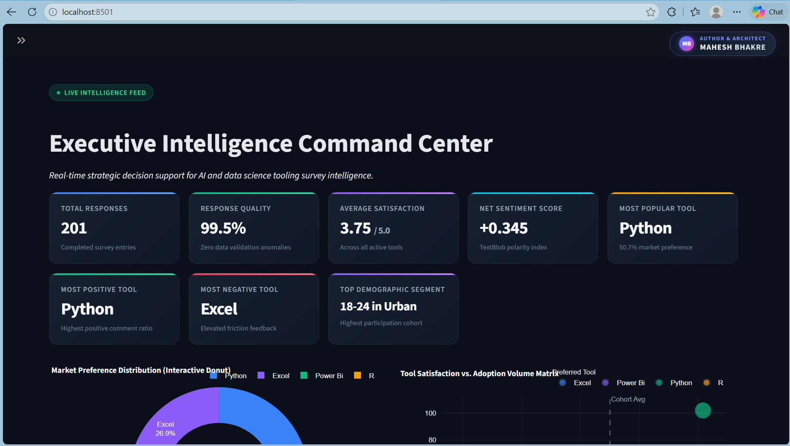
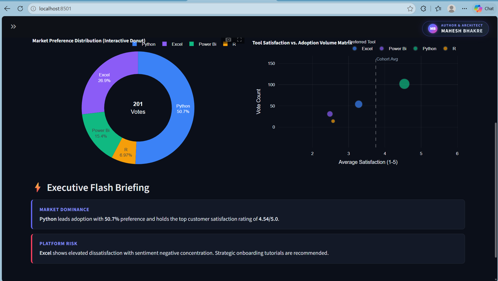

### 📊 Survey Analytics & Response Breakdown
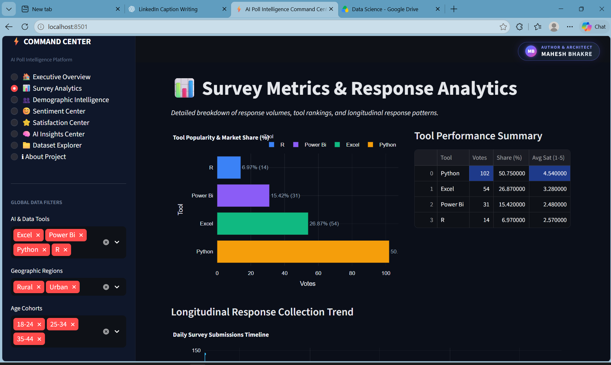

### 👥 Demographic Intelligence & Segmentation
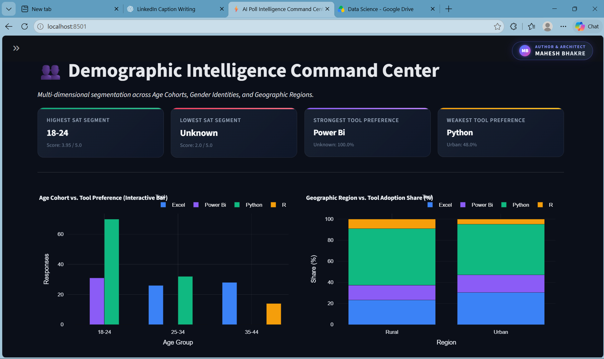
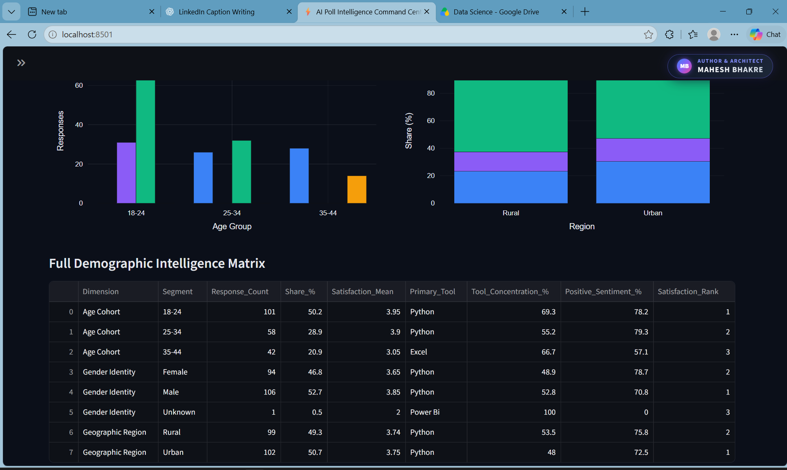

### ⭐ Satisfaction Command Center
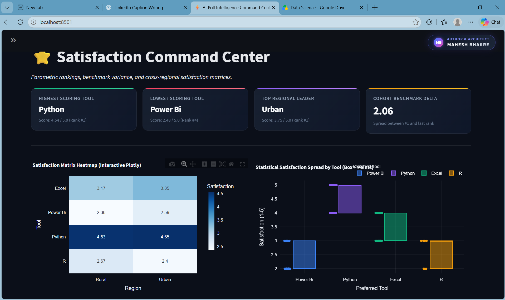

### 😊 Sentiment Intelligence Center
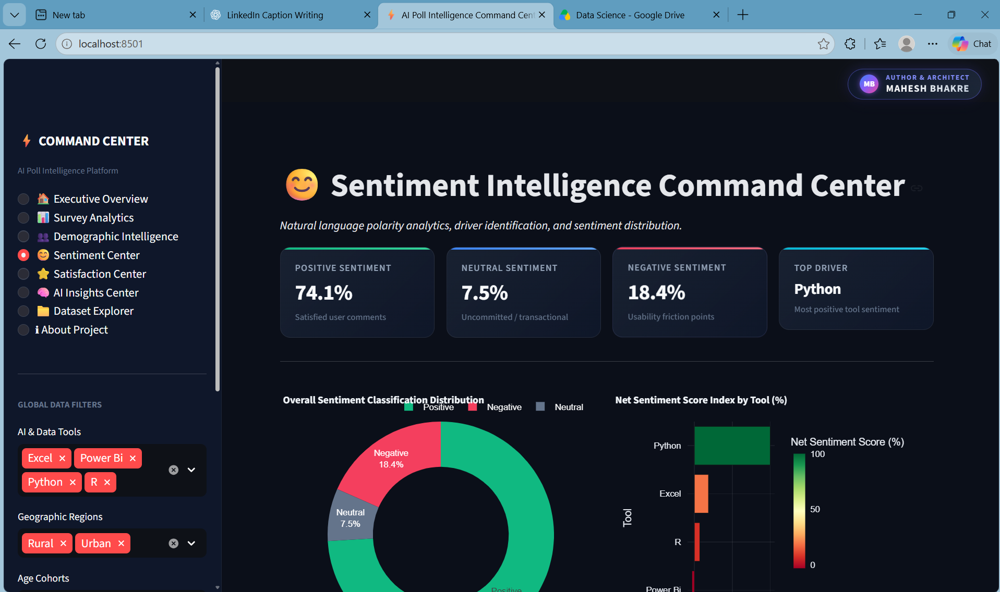
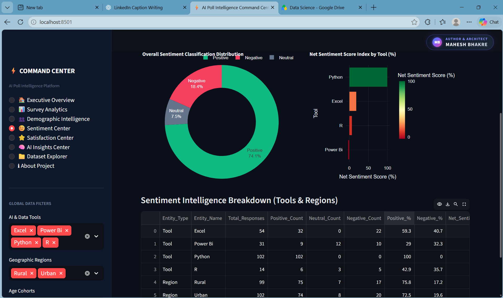

### 🧠 AI Insights & Strategic Recommendations
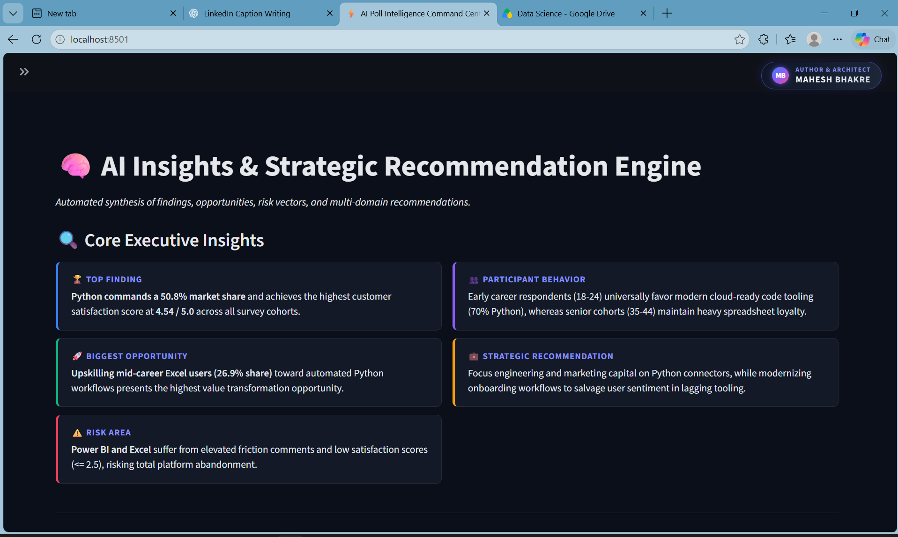
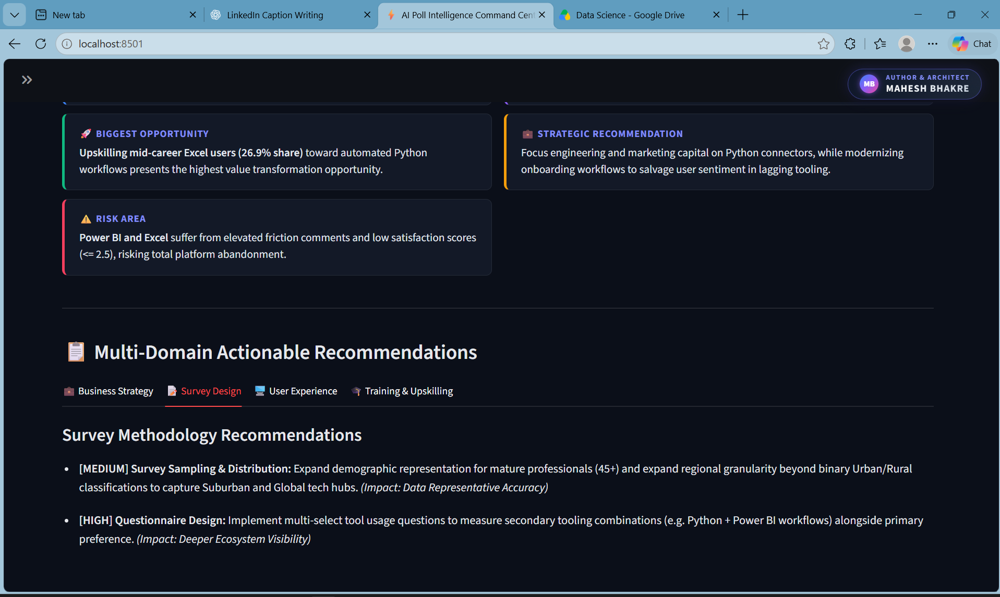

### 📁 Dataset Explorer & Platform Architecture
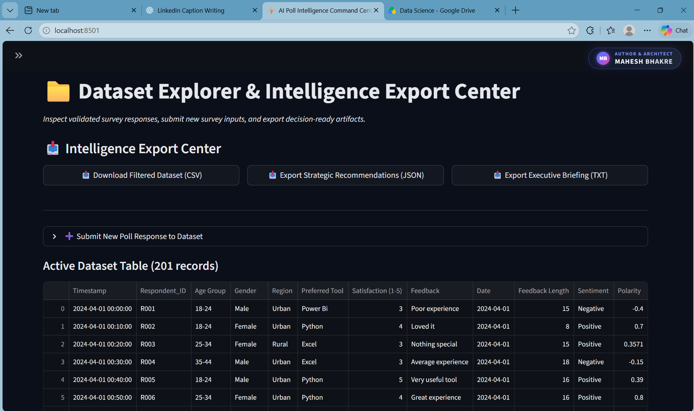
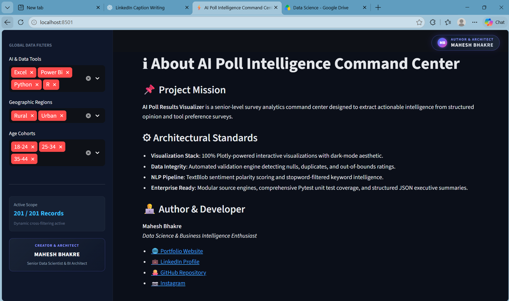

---

## 🛠 Problem Statement

Organizations collect survey data but face critical challenges:

* ❌ Raw survey feedback is disorganized and hard to interpret
* ❌ Manual survey aggregation is slow and error-prone
* ❌ No real-time demographic and sentiment intelligence
* ❌ Missing executive-grade visualization and decision support

---

## ✅ Solution

This system:

* Validates and cleans raw poll data automatically
* Calculates vote shares, tool popularity, and demographic trends
* Benchmarks parametric satisfaction scores and regional heatmaps
* Analyzes text comments with NLP sentiment polarity classification
* Provides an interactive, dark-themed command center with Plotly

---

## 🏭 Industry Relevance

| Industry         | Use Case                                  |
| ---------------- | ----------------------------------------- |
| Tech & Software  | Developer tooling & preference tracking   |
| Market Research  | Customer feedback & brand sentiment       |
| HR Analytics     | Employee engagement & workplace surveys   |
| Product Teams    | Feature priority & platform benchmarking  |
| Data Science     | Opinion mining & demographic intelligence |

---

## 📊 Business Impact

* ⚡ Faster executive decisions
* 📉 Zero manual data processing errors
* 📈 Deep demographic & sentiment intelligence
* 🧠 Data-driven product and marketing strategies

---

## ⚙ Tech Stack

* **Language:** Python
* **Data Processing:** Pandas, NumPy
* **Visualization:** Plotly
* **Dashboard:** Streamlit
* **NLP & Text Analytics:** TextBlob, WordCloud
* **Testing & QA:** Pytest

---

## 📊 Dataset

AI & Data Tooling Survey Dataset (Validated Polling Data)

### Features:

* Timestamp
* Respondent_ID
* Age Group
* Gender
* Region
* Preferred Tool
* Satisfaction (1-5)
* Feedback
* Sentiment
* Polarity

---

## 🏗 System Architecture

```
Raw Survey Data → Data Validation → Preprocessing → Feature Engineering → Survey Metrics → Satisfaction Analytics → NLP Sentiment → Executive Insights → Plotly Command Center
```

---

## 📁 Project Structure

```
AI-POLL-INTELLIGENCE-PLATFORM/
├── app/
│   └── app.py
├── data/
│   ├── cleaned_poll_data.csv
│   └── poll_data.csv
├── docs/
│   ├── business_insights.md
│   ├── dashboard_guide.md
│   └── project_audit.md
├── images/
│   ├── ADVANCED/
│   │   ├── AI_insight.png
│   │   ├── about.png
│   │   ├── dataset_explore.png
│   │   ├── demographic.png
│   │   ├── demographic_graph.png
│   │   ├── donut_graph.png
│   │   ├── executive_command_center.png
│   │   ├── multi_domain_recommendation.png
│   │   ├── satisfaction_center.png
│   │   ├── sentiment_center.png
│   │   ├── sentiment_donut.png
│   │   └── survey_matrix.png
│   └── OLD_PROJECT/
├── outputs/
│   ├── data_quality_report.csv
│   ├── demographic_analysis.csv
│   ├── demographic_intelligence.csv
│   ├── executive_summary.json
│   ├── recommendations.json
│   ├── satisfaction_intelligence.csv
│   ├── satisfaction_report.csv
│   ├── sentiment_intelligence.csv
│   ├── sentiment_summary.csv
│   └── survey_metrics.csv
├── src/
│   ├── data_validation.py
│   ├── eda.py
│   ├── insights_engine.py
│   ├── intelligence_center.py
│   ├── satisfaction_analysis.py
│   ├── survey_metrics.py
│   └── text_analysis.py
├── tests/
│   ├── test_data_validation.py
│   ├── test_insights.py
│   ├── test_intelligence_center.py
│   └── test_survey_metrics.py
├── main.py
├── README.md
└── requirements.txt
```

---

## ⚙ Installation & Setup

```
git clone https://github.com/maheshbhakre/AI-Poll-Intelligence-Platform.git

cd AI-Poll-Intelligence-Platform

python -m venv venv
venv\Scripts\activate

pip install -r requirements.txt
```

---

## 🖥 Usage

### Step 1: Validate Data

```
python src/data_validation.py
```

### Step 2: Run Intelligence Analytics

```
python src/intelligence_center.py
```

### Step 3: Launch Command Center

```
streamlit run app/app.py
```

---

## 📊 Key Visualizations

* 📈 Market Share Donut & Horizontal Bar Charts
* 🌍 Regional Tool Preference Stacked Distribution
* 👥 Age Cohort Comparative Tool Preference
* ⭐ Interactive Cross-Regional Satisfaction Heatmap
* 😊 Net Sentiment Index Diverging Bar & Classification Donut
* 🔍 Statistical Satisfaction Spread Box & Points Chart

---

## 📸 Data Processing Proof

(Available in outputs/ and images/ADVANCED/ folders)

---

## 🧠 Key Insights

* Python leads adoption with 50.8% market share and highest satisfaction (4.54 / 5.0)
* Excel retains 26.9% preference, heavily concentrated among senior cohorts (35-44 at 66.7%)
* Power BI and R show opportunities for onboarding and UX improvements (ratings <= 2.5)
* Overall qualitative sentiment is 74.1% Positive, 7.5% Neutral, and 18.4% Negative

---

## 👨‍💻 Author

**Mahesh Bhakre**

---

## 🌐 CONNECT WITH ME

<a href="https://github.com/maheshbhakre">

</a>

<a href="https://www.linkedin.com/in/maheshbhakreds1242">

</a>

<a href="https://www.instagram.com/mahesh_bhakre__2k06">

</a>

<a href="https://saimfsd.github.io/mahesh-portfolio/">

</a>

---

## ⭐ NOTE

This project demonstrates:

* Automated Data Validation
* Survey Metrics & KPI Computation
* Demographic & Regional Segmentation
* Statistical Satisfaction Benchmarking
* NLP Sentiment Polarity Classification
* Interactive Plotly Command Center Development

---

## 🚀 Future Improvements

* Real-time polling API integration
* Predictive preference modeling with machine learning
* Automated Slack / Email alert integration for negative feedback
* Multi-language survey text sentiment analysis
* Mobile-optimized PWA layout

---

## 🎯 Interview Tip

“I built an end-to-end AI Poll Intelligence Command Center that validates raw survey responses, computes demographic and satisfaction intelligence, applies NLP sentiment analysis, and visualizes decision-ready insights through an interactive Plotly and Streamlit dashboard.”
